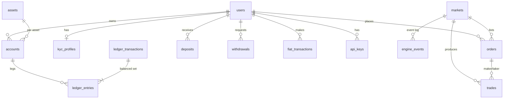

# IDR Spot Exchange: Ledger + Engine Core (MERN backend, MongoDB)

## Run
```bash
npm install
npm run test:pure   # no DB/browser needed: 95 checks (money, book, replay, security, candles, WS protocol, deltas, bot WS, payments/chains, signer, web libs)
npm test            # full suite on an in-memory MongoDB replica set (needs network once, to download mongod)
npm run typecheck
```
Production: MongoDB MUST be a replica set (transactions). Call `initDb()` then `seedBasics()` at boot.

## Relationship diagram


## Money model
- All amounts: integer strings in the asset's smallest unit (IDR=rupiah, BTC=satoshi, ETH=wei, USDT=1e-6). BigInt in code. Regex-checked in Mongoose AND by a MongoDB `$jsonSchema` validator.
- `price` = quote units per 1 whole base. `quoteQty = floor(price*qty/10^baseDecimals)`; both sides use this one number, so no rounding dust.
- Fees are in the quote asset (IDR), floored per fill. Buyer reserve = notional + ceil(max(maker,taker) bps).
- Accounts have `available` + `locked`. System accounts: `hot_wallet` (treasury, debit-normal), `fee_revenue` (credit-normal), `suspense` (debit-normal).
- Accounting equation per asset (checked by `reconcile`): sum(debit-normal) == sum(credit-normal).

## Flows (each one MongoDB transaction)
| Flow | Legs |
|---|---|
| deposit | hot_wallet.avail DR, user.avail CR |
| lock order | user.avail DR, user.locked CR |
| trade | buyer.quote.locked DR (q+fee); seller.quote.avail CR (q-fee); fee_revenue CR; seller.base.locked DR; buyer.base.avail CR |
| withdraw request | user.avail DR, user.locked CR (amount+fee) |
| withdraw complete | user.locked DR; hot_wallet CR (amount); fee_revenue CR (fee) |
| reorg reversal | user.avail DR (what remains); suspense DR (shortfall); hot_wallet CR |

## Guarantees and where they live
| Guarantee | Mechanism |
|---|---|
| No negative balance | checked after every leg in `post()` + DB validator (non-negative integer string) |
| Atomic multi-step | `withTxn()` (snapshot isolation, majority) |
| Lost update / double spend | version-checked updates + snapshot write conflicts + in-process keyed mutex (reduces retries) |
| Exactly-once | `ledger_transactions.idempotencyKey` unique; `(marketId,seq)` unique on trades; `(chain,txHash,vout)` unique on deposits; per-user order idempotency key + request hash |
| Immutable history | append-only guards on ledger/trades/audit/engine_events (app layer). **Also revoke update/delete for the app DB user on those collections.** |
| Crash recovery | engine commands+outputs logged atomically; book rebuilt by re-executing and verifying the log |
| Engine/DB crash gap | order committed -> `pending_submit` -> `resubmitPending()` sweeper; engine submit is idempotent per order id |

## Assumptions (change if wrong)
1. Fees in IDR on both sides; floored per fill. Rounding dust cannot arise (shared quoteQty), so nothing is routed to fee_revenue for it.
2. Market BUY orders require a price cap (reserve is computed from it). Market SELL needs none. Market orders are IOC.
3. Self-trade prevention = cancel the incoming order's remainder.
4. Crypto withdrawals only; IDR withdrawals will use `fiat_transactions` (not built yet).
5. `userId`+`asset` uniqueness is enforced on `owner` key and a partial unique index.
6. Added `ledger_transactions` (header with the unique idempotency key) and `idempotency_keys` (API layer). The spec's "unique idempotencyKey on ledger_entries" cannot hold because one transaction has many entries.
7. One engine process per market (single writer). Multi-instance needs leader election.
8. Single-currency fee revenue reporting, KYC vendor, payment gateway, chain listeners, wallet signing: interfaces only, not built.

## Phase 2: auth, KYC, HTTP API (`src/api`, `src/services/{auth,kyc,apikeys,admin}.ts`, `src/security`)
Start: set `DATA_ENCRYPTION_KEY`, `BLIND_INDEX_KEY` (see `.env.example`), then `npm start`. Tests: `tests/api.test.ts`.

| Area | Design |
|---|---|
| Passwords | scrypt (N=32768, ~32 MiB), per-user salt, constant-time verify, dummy-hash for unknown emails, auto-rehash |
| Sessions | opaque tokens, only SHA-256 stored. Access 15 min; refresh 30 d, rotating, **reuse detection revokes the whole login family** |
| Lockout / rate limit | 5 bad logins => 15 min lock; token buckets per IP, per ip+email, per user (trade/withdraw) |
| 2FA | RFC 6238 TOTP (own implementation, RFC test vectors pass), per-step replay protection, 10 single-use recovery codes, secret AES-GCM encrypted |
| Withdrawals | session only, 2FA mandatory, address format check, admin four-eyes approval, **24 h cooldown** after password/2FA change |
| KYC | NIK AES-256-GCM (AAD bound to user), HMAC blind index blocks one identity on two accounts, uploads via presigned URLs under the user's own prefix, PII views audited |
| API keys | HMAC-SHA256 over timestamp+method+path+body hash, 30 s window, IP whitelist (mandatory for trade), `read`/`trade` only, **never** withdraw/password/2FA |
| Admin | role + mandatory 2FA + optional IP allowlist; every action audited; cannot review/freeze/approve own items |
| Errors | explicit allow-list serializers, stable error codes, requestId, no stack/DB details to clients |

Endpoints (all under `/v1`): `auth/{register,login,refresh,logout,password/{forgot,reset,change},sessions,2fa/{setup,confirm,disable}}`,
`api-keys`, `me`, `balances`, `orders` (POST needs `Idempotency-Key`), `orders/:id` (GET/DELETE), `trades/mine`, `ledger`,
`deposits`, `deposits/address/:asset`, `withdrawals` (POST needs `Idempotency-Key` + `totp`), `kyc`, `kyc/upload-url`,
public `markets`, `markets/:s/book`, `markets/:s/trades`, and `admin/{kyc,withdrawals,users/:id/status,markets/:s/status,reconcile}`.
API-key signing: headers `X-API-Key`, `X-API-Timestamp` (ms), `X-API-Signature` = `hex(HMAC_SHA256(secret, "<ts>\n<METHOD>\n<path+query>\n<sha256(body)>"))`.

Phase 2 assumptions: opaque bearer tokens (not JWT) so every session is revocable; email verification, SMS, device
fingerprinting and a real mailer/object-storage adapter are interfaces only (`Mailer`, `ObjectStorage`).

## Phase 3: market data (candles, ticker, WebSocket) (`src/marketdata`, `src/ws`)
**REST (public):** `GET /v1/markets/:s/candles?interval=1m|5m|15m|1h|4h|1d&limit<=1000&before=<ms>&fill=true|false`,
`GET /v1/markets/:s/ticker`, `GET /v1/tickers` (1 s cache). Candle wire format: `{t,o,h,l,c,v,qv,n}` (strings except `t`,`n`).

**WebSocket `/ws`** (JSON text frames; token goes in the first message, never in the URL):
| Client -> server | Meaning |
|---|---|
| `{"op":"auth","token":"<accessToken>"}` | unlocks private channels until the token expires |
| `{"op":"subscribe","channel":"..."}` / `unsubscribe` | idempotent |
| `{"op":"ping"}` | app-level ping (the server also sends protocol pings every 15 s) |

| Channel | Snapshot | Updates |
|---|---|---|
| `ticker:BTC_IDR` | 24h stats | full stats, coalesced 100 ms |
| `trades:BTC_IDR` | last 50 (newest first, with `seq`) | one per trade; dedupe by `seq` |
| `book:BTC_IDR` | top 50 levels + `seq` | **deltas** `{bids:[[price,qty]],asks:[...]}`, qty `"0"` = remove level; `seq` +1 per delta |
| `candles:BTC_IDR:1m` | last 200, gap-filled | latest candle; replace by `t` |
| `orders` (private) | open orders | order state per change; replace by `id` |
| `balances` (private) | all balances | full list, coalesced |

Server -> client: `authed`, `subscribed`, `snapshot`, `update`, `unsubscribed`, `pong`, `error {code,message}`.
Ordering guarantee: a client never receives an update before its snapshot, and never a duplicate (updates with `seq <= snapshot.seq` are dropped).
Limits: 20 subscriptions, 4 KB messages, 20-message burst then 10/s, 5 protocol errors or 3 failed auths close the socket (1008), 20 connections per IP, slow consumers are dropped (1013), browsers must come from an allowed Origin, private streams stop with `TOKEN_EXPIRED` (re-send `auth`). After a reconnect: re-auth, re-subscribe, the snapshot resyncs you.

Design notes
- Candles are written in the SAME transaction as the trade (per-candle `lastSeq` = idempotent), so a chart can never miss or double-count a trade, even across crashes and replays.
- Book pushes are deltas of the top-50 view (see Phase 4); a sequence gap makes the client resync from a fresh snapshot.
- Feed runs AFTER the ledger commit and never throws into trading; market data is best-effort, the ledger is the truth.
- Hub is in-process. More than one API instance needs a shared bus (Redis pub/sub / NATS) between the engine/consumer and the WS gateways.
- 1d candles align to 00:00 UTC (07:00 WIB).

## Phase 4: web app, admin UI, book deltas, bot WebSocket
**Order-book deltas** (`shared/bookDelta.ts`, used by server and browser): the server diffs consecutive top-50 views and publishes only changed
levels with `seq` = previous + 1. Clients keep `BookSync`: snapshot sets the base `seq`; a delta must be exactly `seq+1`, older ones are ignored,
a gap means "unsubscribe + subscribe" (fresh snapshot). Property-tested: applying every delta reproduces the next top-50 exactly.

**Bot WebSocket (API key).** Authenticate the socket with the same HMAC scheme as REST over the fixed request line `GET /ws` and an empty body:
```
{"op":"auth","apiKey":"ak_...","timestamp":"<ms>","signature":"<hex HMAC_SHA256(secret, ts+'\nGET\n/ws\n'+sha256(''))>"}   -> {"type":"authed","kind":"apikey","permissions":[...]}
{"op":"order.place","id":"c1","market":"BTC_IDR","side":"buy","type":"limit","price":"900000000","qty":"10000000","idempotencyKey":"k-0001"}
{"op":"order.cancel","id":"c2","orderId":"<24 hex>"}
-> {"type":"order.ack","id":"c1","order":{...}}   or   {"type":"order.error","id":"c1","code":"INSUFFICIENT_FUNDS","message":"..."}
```
Rules: order entry needs an API key with `trade` (browser sessions cannot trade over WS); `read` or `trade` unlocks `orders`/`balances` streams;
`idempotencyKey` is mandatory (same exactly-once semantics as REST); every request gets exactly one ack/error with the client's `id`;
error text uses the same allow-list as REST (no internals); 50-order burst then 25/s per connection; bot sockets do not expire but every heartbeat
(15 s) re-checks the key is not revoked and the user not closed, otherwise `KEY_REVOKED` + close 1008 (a DB outage does NOT kick bots).

**Web app (`web/`)**, React 18 + Vite + TypeScript, Indonesian UI. Pages: Login (2FA step), Register, Forgot/Reset (token in the URL fragment), Trading
(ticker bar, TradingView lightweight-charts candles, live depth book, trades, order form with client-side tick/lot/notional/balance checks, % sizing,
two-step confirm, open orders/history/my trades), Wallet (balances, deposit address, 2FA-protected withdrawal with confirm step, histories),
KYC (presigned upload), Security (2FA with QR + recovery codes, password, sessions, API keys with one-time secret), Admin (KYC review with audited PII view,
withdrawal approval/rejection, freeze users, market halt, reconciliation).
Design points: money is BigInt end-to-end (no floats; display truncates), the order idempotency key is reused only while the order is unchanged,
a single-flight token refresh, resilient socket (backoff + jitter, resubscribe, stale-connection watchdog, transparent re-auth), UI role checks are cosmetic
(the API enforces everything). See `web/README.md` for the CSP and deployment.

Added API: `GET /v1/assets` (decimals for formatting), admin KYC view returns short-lived file links (`ObjectStorage.presignDownload`).

## Phase 5: simulated IDR gateway + testnet (`src/payments`, `src/chain`, `src/services/{fiat,chain}.ts`)
Run everything locally with fake money: `PAYMENT_PROVIDER=sim CHAIN_MODE=sim npm start` (+ `cd web && npm run dev`). **The server refuses to boot with either simulator
when `NODE_ENV=production`, `SimProvider` throws in production, and the `/v1/sim/*` routes do not exist unless a simulator is configured.**

**IDR deposits (virtual accounts).** KYC-approved users get a VA per bank (BCA/MANDIRI/BNI/BRI). A (pretend) bank transfer makes the gateway call
`POST /v1/webhooks/payments/sim` with headers `x-webhook-timestamp`, `x-webhook-signature = hex(HMAC_SHA256(secret, "<ts>.<raw body>"))`.
Order of checks: signature over the RAW bytes + 5-minute replay window -> strict event parsing -> VA lookup -> sender-name vs KYC-name match -> credit.
Guarantees: at-least-once delivery is safe (unique `providerRef` + ledger idempotency key), a replay with a different amount cannot change what was credited,
a name mismatch parks the money in `manual_review` (admin releases it), payments below Rp 10.000 are parked as `rejected`, unknown VAs are acknowledged (200) but logged loudly.

**IDR withdrawals.** Payout account must be in the customer's own name (same matcher; companies never auto-match), stored AES-GCM encrypted; replacing it starts a 24 h
withdrawal lock. Flow: request (2FA, Idempotency-Key, locks amount+fee) -> admin approval (four-eyes) -> `createPayout(reference = WD-<id>)` (the gateway dedupes on the
reference) -> status `processing` -> webhook `payout.completed` (burns the lock, treasury down, fee booked) or `payout.failed` (money returned). A gateway outage leaves
the request `approved` and a sweeper retries it exactly once; a webhook that lands before our status update is handled; a failure notice after completion is refused.

**Simulator controls.** User: `POST /v1/sim/bank/transfer {bank?, amount, senderName, duplicate?}` (try a different name, or `duplicate:true`), `POST /v1/sim/faucet {asset, amount}`,
`POST /v1/sim/chain/mine {chain, blocks}`. Admin: `POST /v1/sim/payout/:reference {outcome: completed|failed}`, `POST /v1/sim/chain/reorg {chain, depth, dropTxs?}`.
`SIM_AUTO_PAYOUT=completed|failed|manual` settles pending payouts automatically after ~8 s.

**Testnet chains.** `ChainAdapter` (`src/chain/types.ts`) is the only chain-specific surface; `ChainWorker` does the exchange-side work for any adapter:
scan deposits (re-scanning a reorg buffer) -> re-check every open deposit against the chain each tick (exact confirmations, re-mined into another block, vanished) ->
credit at the required depth -> reverse a credited deposit if its transaction disappears -> broadcast approved withdrawals (idempotent per withdrawal id) and complete them
at the required depth. Solvency check in `reconcile`: the ledger may never owe customers more than custody holds (+ withdrawals already sent but not yet completed).
- `SimChain` (BTC/ETH/TRON look-alike addresses): faucet, mining, confirmations, reorg (txs back to mempool or dropped), payouts. Fully in memory, deterministic.
- `EvmRpcChain` (Ethereum Sepolia / any EVM testnet, JSON-RPC): deposits of native ETH (block scan) and ERC-20 (`eth_getLogs` Transfer filter, 50 recipients per query),
  receipts/confirmations/failed txs, custody balances. It holds NO keys: payouts need a `Signer` (separate hardened service) that is **not built**, so on a real testnet
  deposits work and withdrawals stay `approved` UNLESS the signer service below is connected. Set `CHAIN_MODE=evm EVM_RPC_URL=... EVM_USDT_ADDRESS=...`; USDT then lives on the ETH chain (ERC-20).
- Deposit addresses come from a pool of PUBLIC addresses (`POST /v1/admin/chain/addresses/import`, generated offline); the server never sees private keys.
  Without a pool the simulator generates fake ones. One address per user per chain, never reassigned.
- Not built: real BTC and TRON adapters (sim only), HD-wallet derivation, UTXO handling, sweeping deposit addresses into a hot wallet.

**Signer service (`src/signer`, `npm run signer`).** A separate process that alone holds the hot-wallet key. The exchange API sends it `POST /v1/transfer {reference, asset, to, amount}`
signed with an HMAC (60 s window, shared secret); it never accepts raw transactions or arbitrary calldata. It builds the EIP-1559 transaction itself (native ETH or ERC-20 `transfer`),
so even a fully compromised API can only ask for transfers the policy allows. Safety properties (all tested):
- **Policy, fail-closed:** per-transfer and rolling-24h limits per asset (an asset without limits is refused), never to the zero address, the hot wallet itself, or a token contract.
- **Idempotent per `reference`:** the signed record (nonce, raw bytes, hash) is written durably BEFORE broadcasting. A retry, a crash or a lost response re-sends the SAME bytes with the SAME nonce,
  so a payout can never be paid twice; the same reference with different parameters is refused.
- **Nonces:** allocated under a mutex from max(chain pending count, stored max + 1): concurrent payouts get consecutive nonces; a failed one keeps its nonce reserved and later ones queue behind it.
- **Funds:** refuses when the hot wallet cannot cover amount + gas (or the token balance, or the transfer would revert).
- Crypto (`src/chain/evmCrypto.ts`: keccak-256, secp256k1, RFC 6979, RLP, EIP-1559) is dependency-free and verified against the EIP-155 specification example, published keccak/EIP-55/RLP vectors,
  Node's own ECDH (public keys) and Node's ECDSA verifier (signatures). **For mainnet use audited libraries behind an HSM/KMS**; an env-var key is for a testnet hot wallet only (the signer refuses
  to run with `NODE_ENV=production` on Ethereum mainnet). Not handled: fee-bumping/replacing stuck transactions, multiple signer instances, key rotation.
Sepolia walkthrough: (1) generate deposit addresses offline and import the PUBLIC ones via `POST /v1/admin/chain/addresses/import`; (2) fund the signer's hot address from a Sepolia faucet
(there is no automatic sweeping of deposit addresses, so payouts draw on the hot wallet's balance); (3) run `npm run signer`, then the API with `CHAIN_MODE=evm` and the `SIGNER_*` variables.

**Going to a real gateway:** implement `PaymentProvider` (`verifyWebhook`, `parseWebhook`, `createVirtualAccount`, idempotent `createPayout`) for your PJP
(Xendit, Midtrans, Flip, ...); everything above it (matching, ledger, approvals, sweeper) is unchanged. Real gateways differ in webhook auth (HMAC vs callback token vs
IP allowlist), VA expiry/fixed-amount rules and settlement timing: re-check those assumptions against their docs and run their sandbox.

## NOT done yet (do not skip before real money)
- Shared pub/sub for multi-instance, mobile apps, i18n beyond Indonesian, withdrawal address book, payment gateway (IDR deposit/withdraw), component/E2E tests for the web app.
- Email verification, real mailer, object storage adapter, KYC vendor (Sumsub etc.) integration.
- Event consumer offsets (settlement consumer must persist its last applied seq; handlers are already idempotent).
- Rate limiting, withdrawal address whitelist, daily limits, risk rules.
- Key management: private keys never in this DB. MPC/multisig signer is separate.
- Independent security audit and load test.
